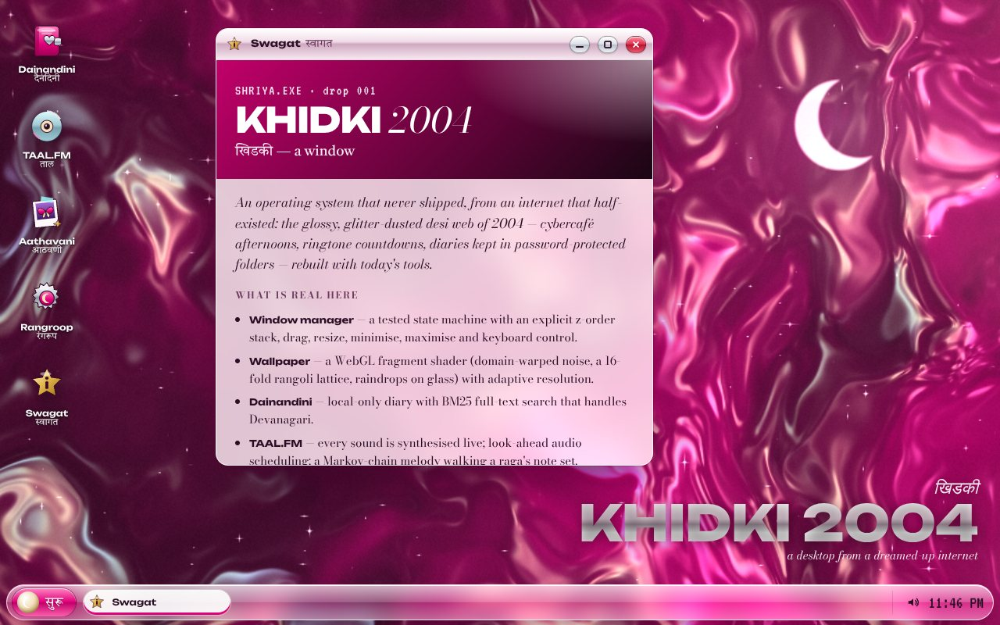
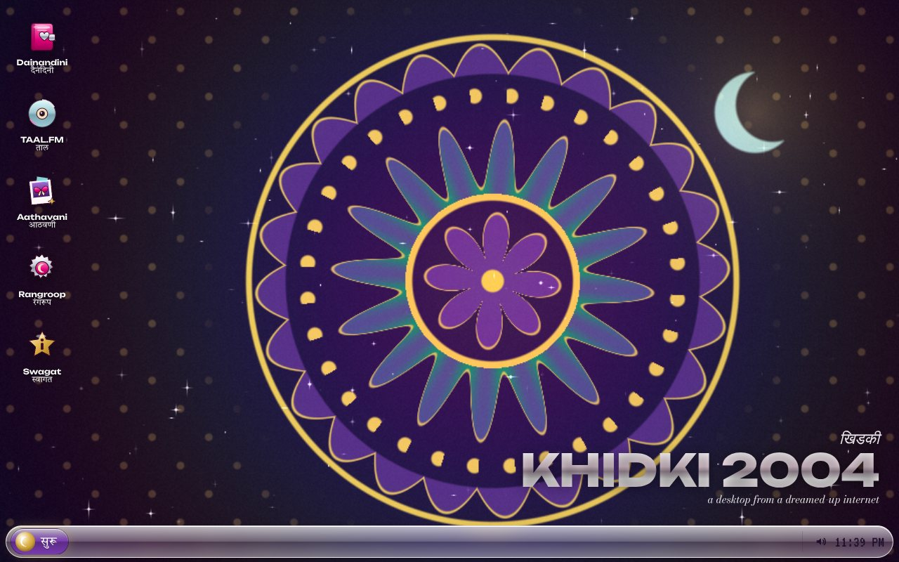
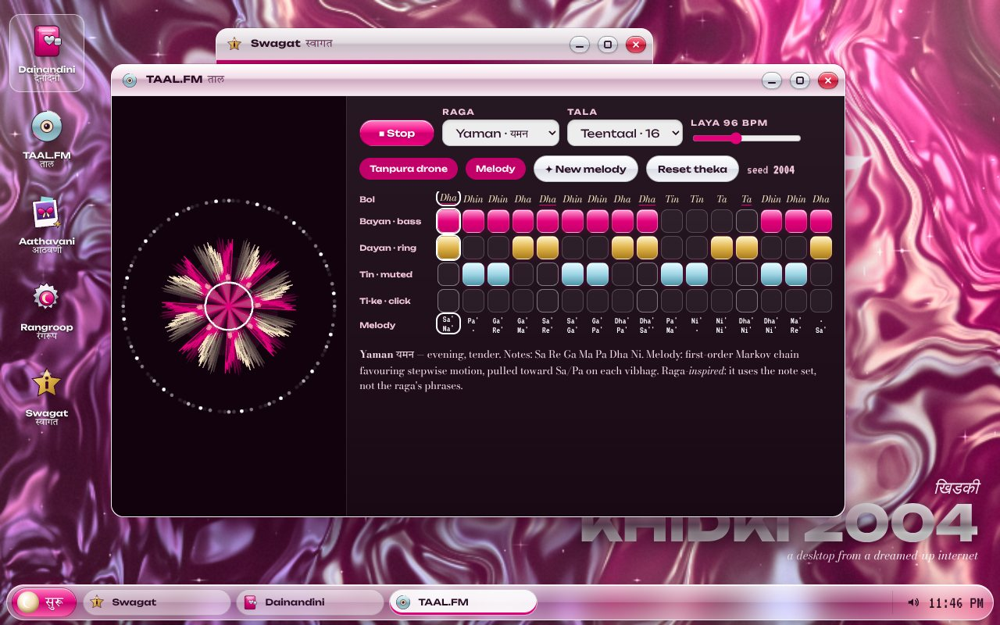
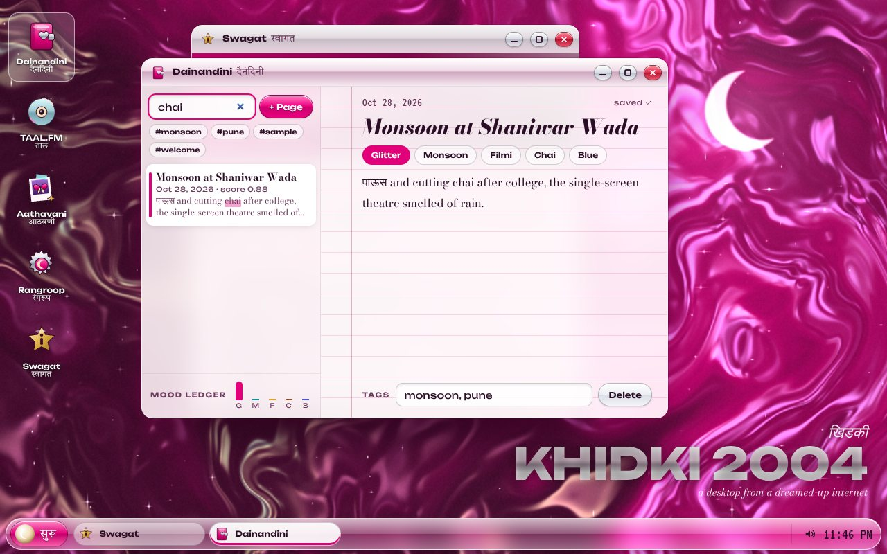
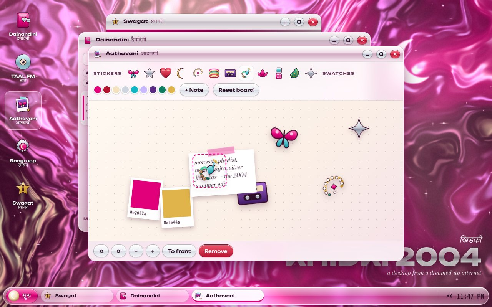
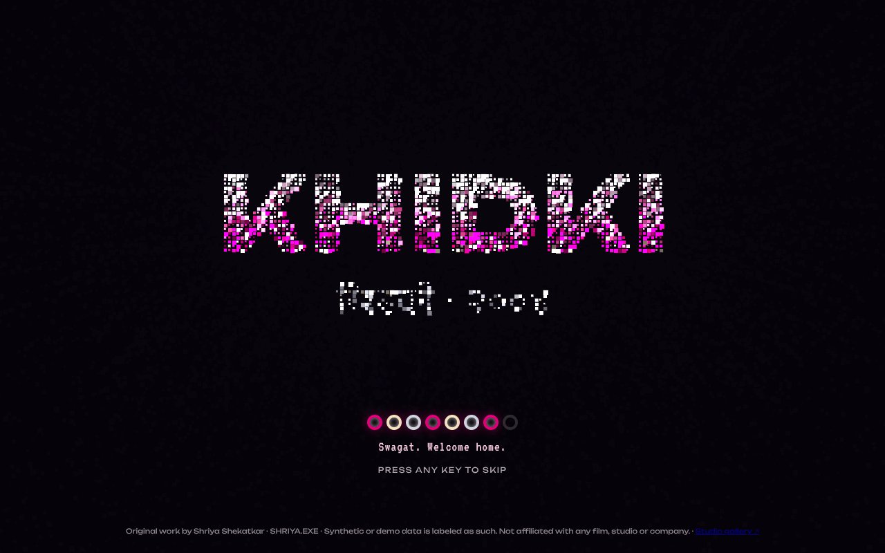
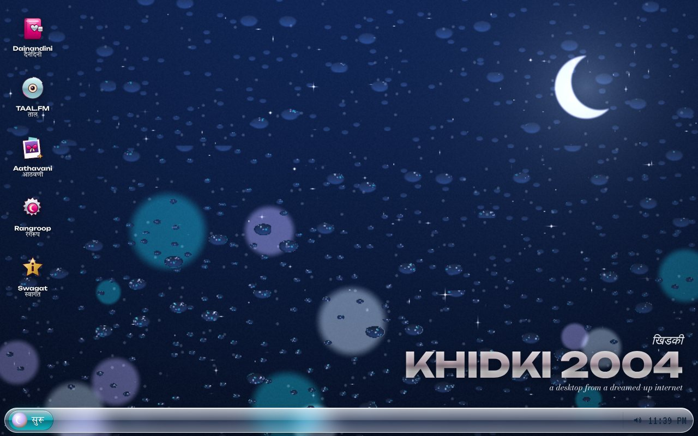
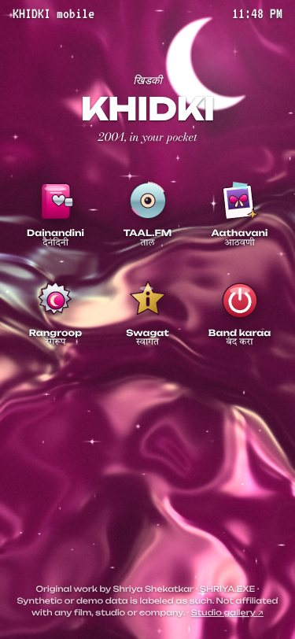
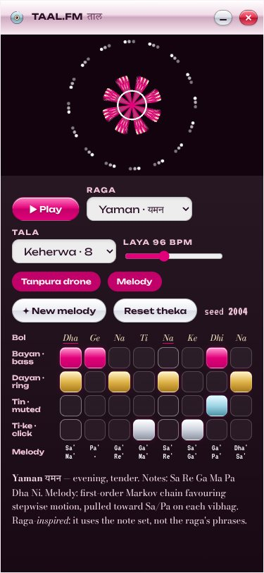

# KHIDKI 2004 · खिडकी

**An operating system that never shipped, from an internet that half-existed** — a glossy, glitter-dusted early-2000s desi desktop, rebuilt in the browser with a WebGL wallpaper, a tested window manager, a BM25-searchable diary, a synthesised tabla sequencer and a scrapbook.

*SHRIYA.EXE · drop #001* · **Live demo → https://shriyashekatkar25-byte.github.io/khidki-2004/**

*Khidki* (खिडकी) is the Marathi word for "window".



| | |
|---|---|
|  |  |
|  |  |
|  |  |

<p> </p>

## What it does

- **Boot sequence** — Up to 3,200 glitter particles spring into the logotype (Latin + Devanagari), a slanted chrome sheen sweeps across, bangles fill as the progress bar. Any key skips.
- **Desktop + window manager** — draggable, resizable, focusable windows with real z-order, minimise / maximise / close, taskbar, the सुरू (*suru*, "start") menu, toasts and a shut-down screen. Keyboard: `Alt+\`` cycle, `Alt+Q` close, `Alt+M` minimise, `Alt+S` start menu, arrows on a title bar move (Shift resizes).
- **Procedural wallpaper (WebGL)** — three modes in one fragment shader: *Silk* (domain-warped fbm, normal-mapped, thin-film iridescence), *Rangoli* (a mandala built ring by ring: lotus, sixteen petals, a 32-dot pulli ring, scalloped border, drifting kolam lattice) and *Monsoon Glass* (lensing raindrops over bokeh). Adaptive resolution, and it pauses when hidden.
- **दैनंदिनी Dainandini (diary)** — create, autosave, tag, mood-label and delete pages; BM25 full-text search with prefix matching, Devanagari tokenisation and highlighted results; a mood ledger chart.
- **TAAL.FM** — a tabla-inspired step sequencer (Keherwa, Dadra, Teentaal thekas), a tanpura drone and a Markov-chain melody walking a raga's note set (Yaman, Bhupali, Bhairavi, Megh). Every sound is synthesised live with Web Audio; an FFT-driven rangoli visualiser reacts.
- **आठवणी Aathavani (scrapbook)** — drag, rotate, resize, layer and delete original SVG stickers (nath, bangles, Paithani-style peacock, kairi, chandrakor, cassette…), colour swatches and notes. Keyboard-operable, saved locally.
- **रंगरूप Rangroop (settings)** — three themes (Rani Chrome, Monsoon Modem, Paithani Midnight), three wallpapers, UI sounds on/off, motion preference, skip-boot, erase-all.
- **Phone mode** — under 720px it becomes a phone launcher with full-screen app sheets.

Everything runs as a static site. Everything you write stays in your browser (localStorage). No accounts, analytics or network calls apart from Google Fonts.

## Run it

```bash
npm install
npm run dev      # local dev server
npm test         # Vitest unit tests
npm run build    # type-check + production build into docs/
```

## Architecture (summary)

TypeScript + Vite, no UI framework. Every piece of logic that matters is a plain, DOM-free module tested on its own (`src/lib/`); the shell and apps only render state.

```
src/
  main.ts          boot → wallpaper → shell, theme application
  boot.ts          particle logotype + bangle progress bar
  shell.ts         desktop, window chrome, taskbar, start menu, launcher, shortcuts
  lib/             windowManager · storage · diary (BM25) · music (talas, ragas, Markov) ·
                   audio (Web Audio synth) · wallpaper (GLSL) · board · settings · icons (SVG)
  apps/            diary · taal · scrapbook · system (settings + about)
  styles/          design tokens + shell CSS
tests/             Vitest suites for window manager, storage/board/settings, diary search, music
```

Full detail: [docs/ARCHITECTURE.md](docs/ARCHITECTURE.md) · art direction: [docs/DESIGN.md](docs/DESIGN.md) · product thinking: [CASE_STUDY.md](CASE_STUDY.md).

## Tech stack

TypeScript 5 · Vite 5 · WebGL 1 (GLSL ES 1.0) · Canvas 2D · Web Audio API · SVG · CSS container queries · Vitest + jsdom · Python Playwright (end-to-end checks).

## Testing status

Recorded on the build that is published:

- `npx tsc --noEmit` — no errors.
- `npm test` — **39 tests passed** in 4 files (window manager 11, diary + BM25 12, storage / board / settings 9, music 7).
- `npm run build` — succeeded (JS ≈ 73 kB, 27 kB gzipped).
- Playwright (Chromium, SwiftShader WebGL) against the built `docs/` at 1280×800 and 375×812: 18 scripted checks passed (opening apps, diary write + search + highlight, sequencer playback and playhead, tala switch, drag / minimise / restore / maximise / Alt+Q, scrapbook drag, theme switch, persistence across reload, no horizontal scroll on mobile). **0 console errors.**

Not tested: real phones, Safari/Firefox, screen readers end-to-end.

## Credits

Visual research references and what was taken from each: [CREDITS.md](CREDITS.md). All icons, stickers, patterns, shaders and sounds are original code.

---

Original work by Shriya Shekatkar · SHRIYA.EXE · Synthetic or demo data is labeled as such. Not affiliated with any film, studio or company.
Studio gallery: https://shriyashekatkar25-byte.github.io/shriya-exe/
